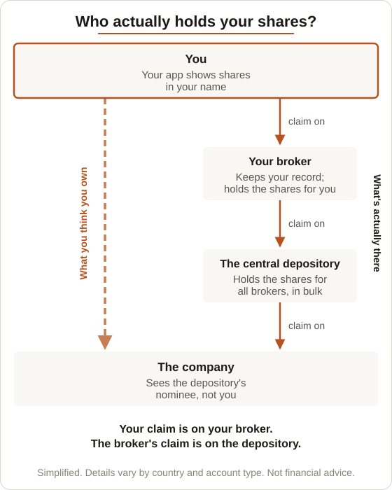

# The Capital Map

A free, independent reference to money, markets and assets: one connected map of cash, bonds, shares, real estate, gold and crypto, plus the skills and relationships that sit underneath them. Sibling of **The Supply Map**, and built on the same engine.

Status: every branch is written (no stubs), including the full failure ladder. A Start view of plain questions is the front door. The Quals tab shows coverage, and the Failures view shows the ladder and which rungs can hit which stores. The build also exports the map as a SQLite database. Seven flows: four written, three planned outlines. Next: P1 content (FX first). See `SCOPE.md` for decisions and open questions.

## How to view it

1. Pull the latest version (`git pull`).
2. Double-click `index.html`. It opens in your browser — no server needed.

Views: **Start** (plain questions, the front door), **Map**, **Flows**, **Quals**, **Cartography**, **Failures** and **Index** (A–Z, linked from Start and the settings menu), plus **About** and **Privacy**. Jobs exist in the engine but are hidden until there is content for them.

## How it's built

All content is Markdown:

| Folder | What goes in it |
|---|---|
| `pages/` | One concept per file. Frontmatter sets its place on the map (`parent`, `order`). |
| `flows/` | Step-by-step walk-throughs. One table whose first two columns are `Step` and `Page`; further columns are detail rows. `status: planned` marks an outline (Step and Page only, every step linked to a page), shown with a Planned tag until its detail is written. |
| `quals/` | One qualification per file: its modules, each mapped to the pages that cover it. See *Qualifications* below. |
| `paths/` | A beginner reading path: an intro, then one `## ` list of 8–12 Core pages in order, each with a reason. Read by the qualifications' loader; readers tick pages as they go. |
| `questions/` | One plain-language question per file: a short answer, then `## Read next` with 3–5 pages in order. See *Questions* below. |
| `jobs/` | Empty. The engine supports job paths; the tab stays hidden until there is content. |
| `about.md`, `privacy.md` | Site pages. |

After any change, rebuild the data file:

```
python3 tools/build.py
```

The build checks the tree (exactly one root, every parent exists, no loops) and every `[[link]]`, then writes `data.js`, which `index.html` loads. Commit `data.js` along with your changes — the site is served as plain static files.

The same build writes the map as a SQLite database, `data/capital-map.sqlite`, plus the same database as SQL text, `data/capital-map.sql`. Commit both too. They're byte-identical when nothing has changed, and the Failures view links to them for download. Tables, starter queries and practice questions are in `data/README.md`.

Full file formats are documented at the top of `tools/build.py`.

## Page frontmatter

```
---
id: gold                     # unique, lowercase, hyphens; matches the file name
title: Gold
parent: money                # id of the parent page on the map
order: 3                     # position among siblings
summary: One line, shown on hover and in search
group: What you can own     # top-level branches only: the cluster it sits in on the map
tags: gold, money            # optional
level: advanced              # optional — hidden in Core view
sources: Author, Title       # optional, semicolon separated
# Cartography of Wealth (optional — only for stores of wealth)
tier: 2                      # 1 inside you · 2 private/bearer · 3 legible; "2-3" for a store that spans tiers
killer: physical theft — the simplest attack on a bearer asset
traits: private, no yield, bearer, transferable
place: 72, 24                # x inside you→outside you, y hidden→recorded; both 0–100. Plots the page on the Cartography view
span: 36, 63                 # optional — a y range drawn as a whisker, for a store that spans tiers
killer_kind: Theft and self-error   # the filter group for the killer; required with place
fails_at: confiscation      # stores only — the failure-ladder rungs that can hit it (rung page ids)
# Failure ladder (optional — only on rung pages)
rung: 8                     # position on the ladder, 1 (closest to you) upwards; numbered with no gaps
rung_name: Confiscation     # the rung's name on the ladder
backstop: Courts, constitutions, compensation   # what is supposed to protect you at this rung
---
```

Pages with fewer than 60 words show as dashed **stubs** on the map.

**The failure ladder.** A rung is any page with `rung:`, not just a child of the When Things Fail hub: Stablecoins and Bank Backstops are rungs 3 and 4 but keep their own parents. The ladder table on the hub must match the rung fields. A store's `fails_at` lists the rungs whose page says, in *What it kills* (or the equivalent), that they can hit it. Write those links positively: a sentence such as "It doesn't touch [[gold]]" is a link, not a hit. The build fails if `fails_at` names something that isn't a rung, appears on a page that isn't a store, or if the rungs aren't numbered 1 to N.

**Groups.** Every top-level branch has a `group`. The map draws each group as a cluster with a small heading, and the Index puts a heading before each group. A group is a label, not a level: it adds no page and no click. The build fails if a branch has no group, if a group's branches aren't next to each other in `order`, or if a page below the top level has one.

## Writing rules

- **Timeless.** No prices, dates of current events or forecasts.
- **Neutral.** Explain how things work; never tell the reader what to buy or sell.
- **One page per concept.** Link with `[[page-id]]` or `[[page-id|custom text]]`. Ids are lower-case letters, digits and hyphens. The build fails on a link to a page that doesn't exist, on anything in double brackets that isn't a valid link (`[[sequence risk]]`, `[[Enough]]`), and on stray `[[` or `]]`.
- **Placement on the Cartography of Wealth is a judgment** and is labelled as one on every page that carries it.

## Qualifications (`quals/`)

Each file is one qualification or course. Every module heading starts with a short code, used for search and the module chips (e.g. `CFA1-FI`). Codes must be unique within a file.

```
---
id: cfa-l1
title: CFA Program — Level I
short: CFA I                 # label on chips and in the focus menu
order: 1
status: planned              # optional: a placeholder with no pages yet
summary: One line for the card
---
Intro paragraph.

## CFA1-FI — Fixed Income
- [[bonds]] — optional short note
> Optional note shown under the module heading (e.g. why it's out of scope or only partly mapped)

## CFA1-ETH — Ethical and Professional Standards
> Outside this site's scope: …
```

- **Every module stays on the page**, mapped or not, so the whole syllabus is visible. An empty module shows *Not mapped yet*, or *Out of scope* when its note starts "Outside this site's scope".
- A **placeholder** (`status: planned`) lists its modules with no pages. Remove the `status` line once the first page is mapped. The build fails if a mapped qualification has no pages, or a planned one has some.
- Module names follow each body's published outline, in our own words for notes. Check the outline when it changes (CFA renamed several topics from February 2027).

### Coverage

The Quals tab shows how much of each qualification the map covers, and the total across all of them. The build gives every module one of four states, from its pages and its note:

| State | Rule | Counted? |
|---|---|---|
| **Mapped** | lists pages, and no "Partly mapped" note | yes |
| **Partly mapped** | lists pages, and its note starts `Partly mapped:` | shown, but not in the % |
| **Not mapped yet** | no pages | yes, as not mapped |
| **Out of scope** | its note starts `Outside this site's scope` | no |

**Coverage % = mapped modules ÷ in-scope modules.** Placeholders count as not mapped in the total. "Mapped" means at least one page covers the module's core idea, not the whole syllabus, so every module also shows its number of pages: a one-page module is visible as thin. When a module's pages leave a known gap, say so with a `> Partly mapped: …` note rather than leaving it counted as mapped.

The build fails if a note contradicts the pages: an out-of-scope or `Not mapped yet` module that lists pages, or a `Partly mapped` module that lists none.

## Questions (`questions/`)

The Start view is the front door for newcomers: questions in the words people actually use, each with a short answer and an ordered route into the map.

```
---
id: bank-safe                # matches the file name
question: Is my money safe in the bank?
group: Is my money safe?     # one of the groups listed in tools/build.py
order: 1
---
Two to seven plain sentences. No jargon, or explain each term in the same sentence.

## Read next
- [[bank-deposits]] — one line on why to read it
- [[deposit-insurance]] — ...
```

- **Plain:** aim for a reading age of 12 to 14. Readability is measured in the questions test, but honesty beats the score.
- **Neutral and timeless,** like every page. Answers are country-neutral; where a rule differs by country, say so.
- **Read every routed page first,** and make sure the answer agrees with it.
- **The build fails** on a missing `?`, an unknown group, an answer outside 2 to 7 sentences, a broken or repeated route link, a route step without a reason, or a route shorter than 3 or longer than 5.
- **Pages on a route** show an "Answers" link back to each question.

**The beginner path** (`paths/start-here.md`) sits at the top of Start: 8–12 Core pages, in reading order, each with a one-line reason. Readers tick pages as they finish them (the same per-page ticks the qualifications use, saved in the browser), and a Continue button opens the next unticked page. The build fails if a path has the wrong number of pages, uses an advanced page, or leaves a step without a reason.

## Hub pages

A top-level branch page, once written, is a **hub**. Every hub has the sections *What it is*, *Why it exists*, *How it works*, *What goes wrong*, *Connects to* and *Check yourself* (at least two quiz questions), runs to at least 400 words, and links every child page. Links to **advanced** children go only inside its *Going deeper* section, so Core view never shows them. Quizzes go above *Going deeper*, because that section runs to the end of the page and is hidden in Core.

## Figures

Diagrams live in `assets/figures/` as SVG files named **`<page-id>-<name>.svg`**, after the page they belong to (`shares-ownership-chain.svg`). Embed one on a line of its own:

```

```

- **The build turns it into a captioned figure** that opens full size when tapped (on phones a figure shrinks to about 60%, so a "Tap to enlarge" hint shows there). The width and height come from the SVG's `viewBox`.
- **The build fails** on a missing file, a file outside `assets/figures/`, a name that doesn't start with a page id, alt text under 20 characters, a missing caption, or an image that isn't on its own line.
- **Alt text:** use the SVG's own `<desc>`, word for word. An `` hides the SVG's title and description from screen readers.
- **Facts in a figure are page facts:** they must match the page, and the page credits any source. Don't draw what the site already renders live from data (the failure ladder is the Failures tab).
- **Style:** a white card with a light border and system fonts, so it reads as a deliberate card in dark mode (dimmed slightly there). The figures test checks that no text spills outside the drawing.
- **Every file in `assets/figures/` must be used somewhere.**

## Link previews

`assets/share.png` is the 1200×630 image shown when the site is shared. It's rendered from HTML with Playwright (the template lives with the helper tools, outside the repo). `og:url` and `og:image` in `index.html` must be absolute and match the live address: `https://thecapitalmap.pages.dev/`.

## Going public — the switches

The site stays private until these are done:

1. **Address.** If the final address isn't `https://thecapitalmap.pages.dev/`, change `og:url` and `og:image` in `index.html`.
2. **Analytics.** Turn on Cloudflare Web Analytics for the Pages project in the Cloudflare dashboard (no code needed). `privacy.md` already describes it.
3. **Contact.** `privacy.md` names the owner-approved public contact handle. It's the only allowed exception to the no-usernames rule.
4. **Access.** Remove any Cloudflare Access policy from the Pages project.
5. **Search engines** (only when ready to be found): remove the `noindex` meta tag in `index.html`, change `robots.txt` to allow crawling, and delete the `X-Robots-Tag` rule in `_headers`. Some link-preview crawlers also respect `robots.txt`, so previews may not show until this step.
6. **Check the preview** with the social network's link-preview inspector once the site is reachable.

## Content rule

Money, markets and assets only. No personal, career or employer details, and no names, emails or locations. Worked examples use fictional data. Write in your own words; credit outside sources in a page's `sources:` line, and personal study files as `Study notes`.

## Tests

The browser test suites live in [`tests/`](tests/README.md), so a change and its tests travel in the same PR. The privacy scan stays **outside** this repo and is never committed. The suites run through one runner (`tests/run_tests.py`) with an 80/20 rule:

- **Content-only changes** (pages, flows, qualifications, docs): the branch's own suites plus a smoke set, desktop width only — a couple of minutes.
- **Engine or layout changes** (`assets/`, `tools/`, `index.html`, `_headers`, `robots.txt`): every suite at all three screen widths.

The runner picks the mode from what the branch changed. Read the results before pushing.
